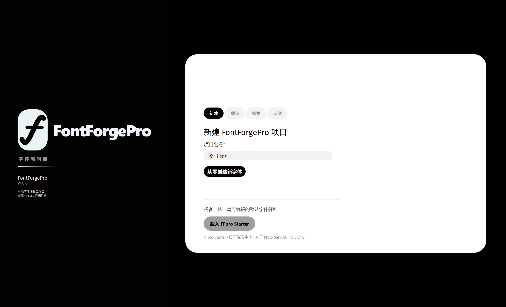
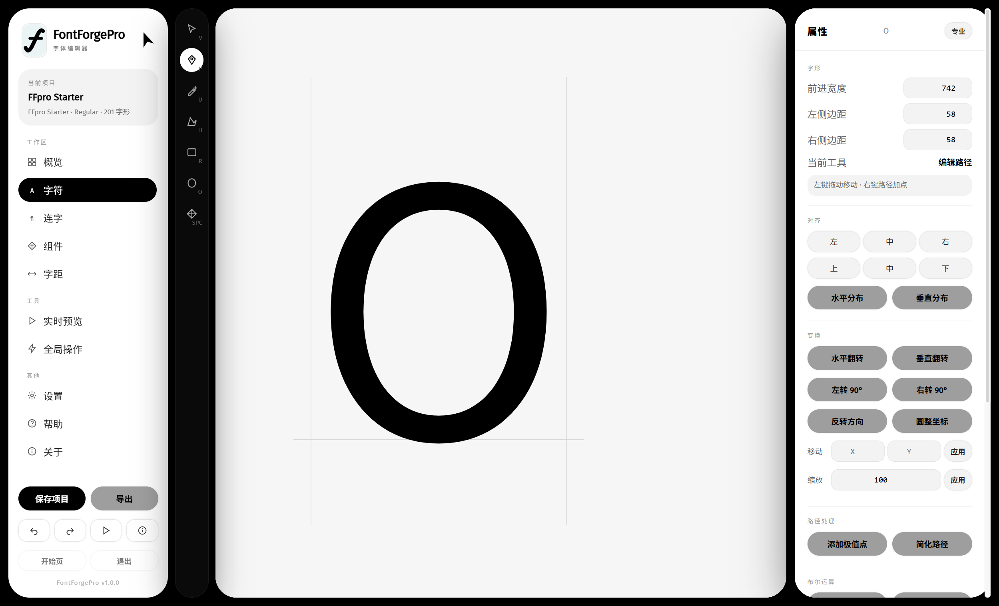

# FontForgePro (FFpro)

FontForgePro is a local, offline desktop font editor for Windows, built with
Electron and based on the Glyphr Studio 2.10.0 engine.

> FontForgePro is an independent project and is **not affiliated with the
> FontForge project**. It is built on Glyphr Studio 2.10.0 under GPL-3.0.



## Features

- Monochrome desktop UI with Chinese/English localization that follows the
  Windows display language.
- Direct point editing with hover vertices, 1:1 vertex dragging, right-click
  point insertion and control-handle editing.
- Transforms: flip, rotate 90°, reverse direction, round coordinates, move and
  scale.
- Align, distribute, add extrema, simplify, and boolean operations (union,
  subtract, intersect, exclude, divide, unite all).
- Layers, history, guides, quality checks, character info, components,
  ligatures and class-based kerning.
- Built-in font preview at eight sizes, and export to TTF, OTF, WOFF, WOFF2 and
  SVG through the native Windows save dialog.
- Fully offline: tutorial content is bundled, analytics and external requests
  are blocked.



## Download

See the [Releases](https://github.com/username-xusir/FontForgePro/releases)
page for the Windows x64 build.

## Run from source

Requirements: Windows 10/11, Node.js 22+, npm.

```bash
npm install
npm start
```

Build a portable Windows application:

```bash
npm run package
```

The output is written to `release/FFpro-win32-x64/`.

## Keyboard shortcuts

| Key | Action |
| --- | --- |
| V / A | Select |
| P / B | Path edit |
| U / E | Add path point |
| H / W | New path |
| R / M | Rectangle |
| O / Q | Oval |
| Space | Temporary pan |
| Ctrl+Z / Ctrl+Y | Undo / redo |
| Ctrl+S / Ctrl+E | Save / export |
| Ctrl+0 / Ctrl+1 | Fit view / 100% |
| [ / ] | Move layer down / up |

## License

GPL-3.0. See [LICENSE](LICENSE) and [THIRD_PARTY_NOTICES.md](THIRD_PARTY_NOTICES.md).

The corresponding source of the bundled Glyphr Studio 2.10.0 engine is included
in `vendor/Glyphr-Studio-2.10.0-source.zip`.
