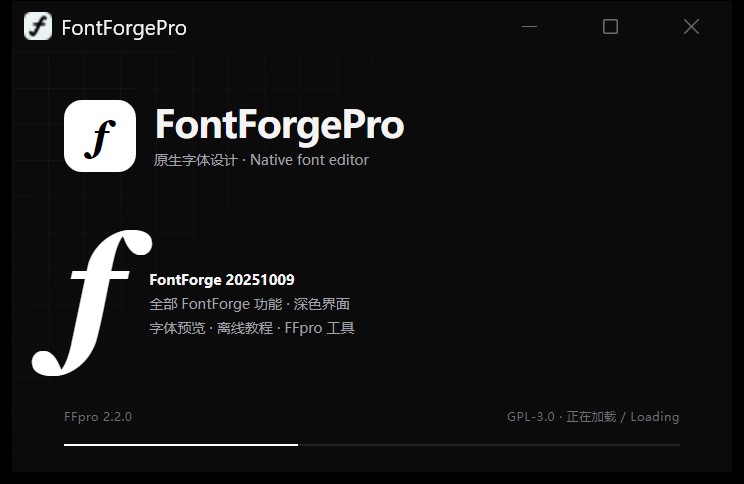
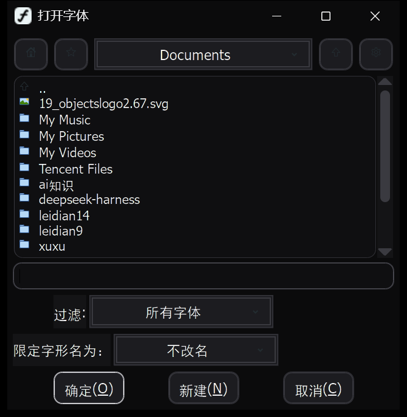
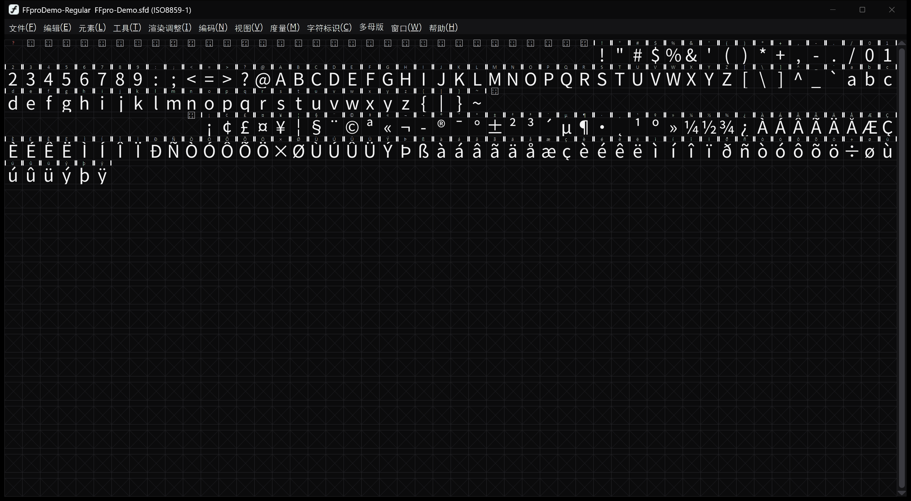
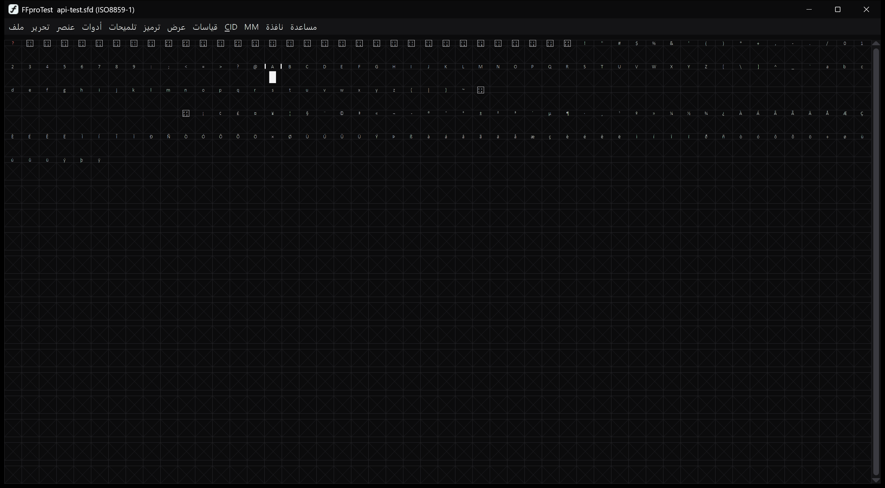
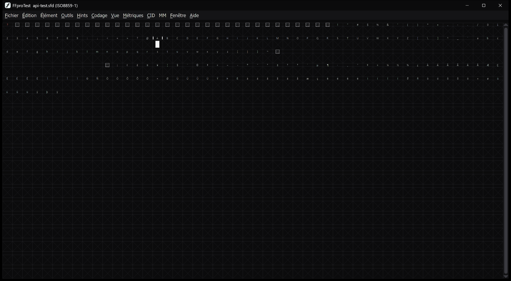
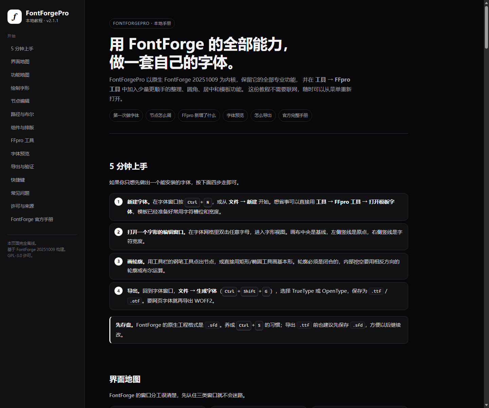
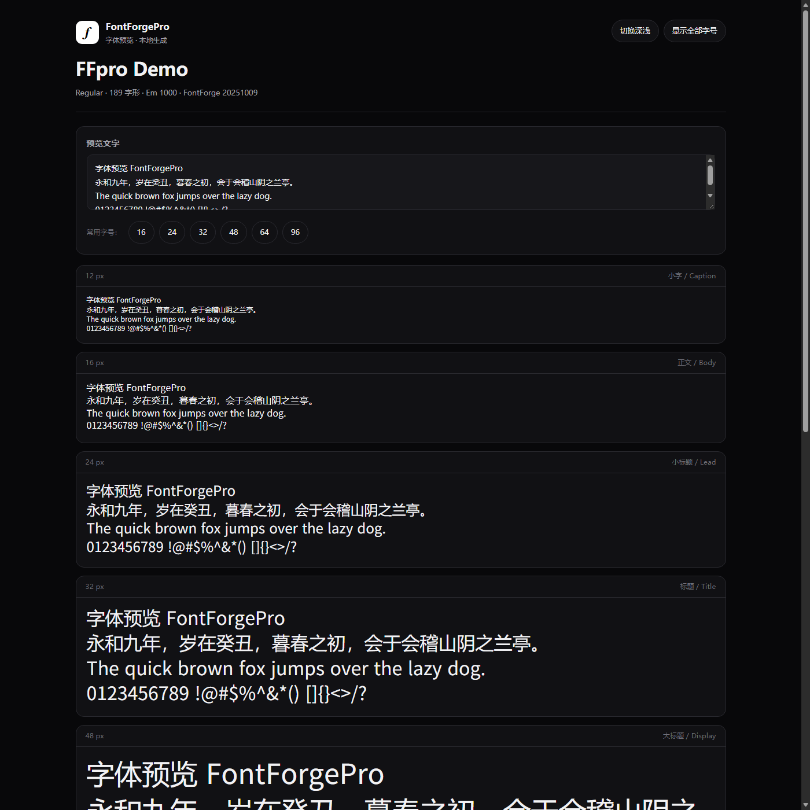

# FontForgePro (FFpro) 2.3.0

A Windows font editor built on the **native FontForge 20251009** application.
FontForgePro keeps all of FontForge's professional features and adds a dark
monochrome appearance, Chinese/multilingual UI handling, a small set of FFpro
workflow tools, a starter font, and an offline manual.

> FontForgePro is an independent product built on FontForge. It is not
> affiliated with or endorsed by the FontForge project.
















## Download

Builds are published on the
[releases page](https://github.com/username-xusir/FontForgePro/releases).

The Windows package is self-contained: FontForge, GTK, Python 3.12, the FFpro
plugin, the starter template, and the offline manual are all included.

- `FontForgePro-v*-win64.zip` — Windows 10/11 x64
- `FontForgePro-v*-win-arm64.zip` — Windows 11 ARM64, running through x64
  emulation; native ARM64 is pending an upstream FontForge ARM64 build

## What is included

### All of FontForge

The application is the real FontForge 20251009 binary, not a reimplementation.
That means the full feature set is present:

- Glyph drawing, point editing, Spiro, layers and background layers
- Boolean operations, overlap removal, simplification, extrema, hinting
- Components/references, anchors, ligatures, kerning, OpenType features
- Metrics view, font info, validation, Python and legacy scripting
- Multiple masters and variable-font workflows
- Import/export of OpenType, TrueType, WOFF, SVG, UFO, and many other formats

### FFpro additions

Found under **工具 → FFpro 工具** (Tools → FFpro Tools):

| Command | What it does |
| --- | --- |
| 字体体检 / Font Audit | Counts glyphs, reports empty/zero-width/negative-width glyphs, runs FontForge validation |
| 字体预览… / Font Preview... | Exports a temporary WOFF2 and opens a local preview page with editable text and eight sizes |
| 补齐基本字符集 / Add Basic Character Set | Adds ASCII, Latin-1, and common punctuation slots with sensible widths |
| 字形清理 / Clean Glyphs | Rounds coordinates, adds extrema, and corrects contour direction |
| 水平居中 / Center Glyphs | Centers outlines inside the advance width |
| 圆角拐点 / Round Corners | Rounds sharp line-to-line corners to a chosen radius |
| 打开模板字体 / Open Starter Font | Opens a copy of the FFpro Starter template |
| 新手引导… / Getting Started... | Opens the first-run guide again |
| FFpro 中文教程 / FFpro Manual | Opens the bundled Chinese tutorial |
| FontForge 官方手册 / FontForge Manual | Opens the offline mirror of the official FontForge documentation |
| 界面语言… / Interface Language... | Switches the UI language; writes `%APPDATA%\FontForgePro\language.txt` and applies after restart |
| 关于 FontForgePro / About | Version, license, and source information |

### Appearance

- Dark, monochrome editor theme for the font grid, glyph canvas, menus, and
  dialogs
- Modern rounded controls, custom FFpro splash screen, and a consistent
  black/white palette
- **First-run guide** with Skip / Back / Next / Start buttons; reopen it from
  **Tools → FFpro Tools → Getting Started...**. The guide is localized for
  Chinese (Simplified/Traditional), English, French, Russian, and Spanish.
- **High-DPI aware UI**: the bundled FontForge binary declares DPI awareness and
  the launcher writes a resource with the monitor DPI, so menus, dialogs, and
  controls stay crisp instead of being bitmap-scaled by Windows. The base UI
  font is 13 pt, and the default font-view window is sized from the screen so
  low-resolution displays get fewer, larger cells instead of a wall of tiny
  slots.
- Bundled **Noto Sans SC** UI font (SIL OFL 1.1) used after Microsoft YaHei UI,
  so Chinese labels render on Windows installations without Chinese fonts;
  Segoe UI remains the Arabic fallback.
- Font preview: temporary WOFF2 export opened in a local page with editable text,
  eight sizes (12–144 px), paragraph specimen, and light/dark modes. Preview
  text auto-saves in the browser and has a one-click "保存文字" button — no
  filename dialog.
- Offline mirror of the official FontForge 20251009 documentation (about 700
  files, 9 MB) with a Chinese navigation hub and working local search
- Separate settings directory (`%APPDATA%\FontForgePro`) so an existing
  FontForge installation is not modified

### Languages

The UI language follows the Windows display language automatically. The
launcher maps the system locale to a POSIX locale for FontForge and picks the
Arabic UI font resource when needed.

Supported UN working languages:

| Language | UI | Notes |
| --- | --- | --- |
| 中文（简体） | Complete FontForge catalog | Default on Chinese Windows |
| 中文（繁體） | Complete FontForge catalog | `zh-TW` / `zh-HK` |
| English | Native UI | Fallback |
| Français | Complete FontForge catalog | |
| Русский | Complete FontForge catalog | |
| Español | Complete FontForge catalog | |
| العربية | Partial Arabic catalog | Menu bar, common menus, and dialog buttons; remaining strings fall back to English |

FontForge's German, Italian, Portuguese, Japanese, Korean, Polish, Turkish,
Ukrainian, Vietnamese, Catalan, Greek, Croatian, Malayalam, and Georgian
catalogs are also available when the system uses them.

A manual override is available at **Tools → FFpro Tools → Interface Language...**.
It writes `%APPDATA%\FontForgePro\language.txt`; restart FontForgePro to apply.
`FFPRO_LANG` (for example `fr_FR` or `ar`) overrides the file for a single run.

Arabic support is partial: FontForge does not ship an Arabic catalog, so
FontForgePro adds one for the menu bar, common menu items, and dialog buttons.
The rest of the Arabic UI falls back to English. The layout remains
left-to-right because FontForge's custom widget toolkit does not mirror the UI.

### Windows ARM64

A separate `FontForgePro-v*-win-arm64.zip` package is produced for Windows 11
ARM64. Upstream FontForge 20251009 has no ARM64 Windows build, so this package
uses Windows' built-in x64 emulation (Prism). It is functional but not native
ARM64. See [ARM64.md](ARM64.md) for the native ARM64 build path.

## Quick start

1. Run `FontForgePro.exe`.
2. Open a font, or use **工具 → FFpro 工具 → 打开模板字体** for a starter file.
3. Double-click a glyph, draw with the pen/shape tools, and set the width line.
4. Save the project as `.sfd`, then use **文件 → 生成字体** to export TTF/OTF/WOFF2.
5. Open **工具 → FFpro 工具 → FFpro 中文教程** for the full Chinese walkthrough.
6. Change the UI language at **工具 → FFpro 工具 → 界面语言…** if needed.

## Build from source

Requirements:

- Windows 10/11 64-bit
- [FontForge Windows Builds](https://github.com/fontforge/fontforgebuilds)
  installed at `C:\Program Files\FontForgeBuilds` (version 20251009)
- .NET Framework 4.x C# compiler (`csc.exe`)
- PowerShell 5.1+

Build:

```powershell
powershell -NoProfile -ExecutionPolicy Bypass -File build.ps1
```

Output:

- `dist\FontForgePro\` — runnable application directory
- `release\FontForgePro-v2.3.0-win64.zip` — release archive
- `release\FontForgePro-v2.3.0-win64.zip.sha256`

Install for the current user:

```powershell
powershell -NoProfile -ExecutionPolicy Bypass -File install.ps1
```

This copies the app to `%LOCALAPPDATA%\Programs\FontForgePro`, creates Desktop
and Start Menu shortcuts, and registers an uninstall entry under
`HKCU\Software\Microsoft\Windows\CurrentVersion\Uninstall\FontForgePro`.

ARM64 (Windows 11 x64 emulation package):

```powershell
powershell -NoProfile -ExecutionPolicy Bypass -File build-arm64.ps1
```

The result is `release\FontForgePro-v2.3.0-win-arm64.zip`. See
[ARM64.md](ARM64.md) for the native ARM64 build path.

## Project layout

```
src/Launcher.cs              Windows launcher: profile, locale, DPI, branding, icons
src/WelcomeForm.cs           First-run guide / onboarding wizard
src/fontforge.manifest       DPI-awareness manifest patched into the kernel
src/patch-manifest.ps1       Replaces the embedded RT_MANIFEST resource
src/make_resources.py        Generates the FontForge appearance resource
src/build_ar_catalog.py      Builds the partial Arabic UI catalog
plugins/ffpro_tools.py       FFpro FontForge plugin
plugins/*.dist-info/         Entry-point metadata that lets FontForge discover it
resources/ffpro.resources    Dark modern theme (rounded controls, splash)
resources/ffpro-ar.resources  Arabic variant using Segoe UI
resources/ffpro-splash.png   Custom splash image
resources/fonts/             Bundled Noto Sans SC UI font + OFL license
resources/locale/ar/         Partial Arabic gettext catalog
help/welcome.html            Onboarding guide (reopenable from the menu)
templates/FFpro-Starter.sfd  Starter font with basic character slots
help/                        Offline Chinese manual, preview template, official docs hub
help/fontforge-docs/        Mirrored official FontForge 20251009 documentation
tools/mirror-docs.mjs       Rebuilds the offline documentation mirror
build.ps1 / install.ps1      Build and install scripts
build-arm64.ps1             Windows ARM64 (x64 emulation) package
ARM64.md                    Native ARM64 build notes
vendor/                      FontForge source (GPL compliance)
```

The launcher creates `%APPDATA%\FontForgePro\FontForge\prefs` on first run and
points `ResourceFile` at `resources\ffpro.resources`, or
`resources\ffpro-ar.resources` for Arabic. FontForge is launched with a POSIX
locale matching the Windows UI language and a private `APPDATA` so settings stay
isolated. The splash is enabled through preferences, not the `-nosplash` flag.

The plugin is discovered through the standard `fontforge_plugin` Python entry
point group, so it also works with a normal FontForge installation if the
package is placed on `sys.path`.

## Relationship to the previous FFpro

The earlier `v1.0.0` release was an Electron application built on Glyphr Studio.
It remains available from the repository's release history. Version 2.3.0 is a
different foundation: the native FontForge application. Font files and `.sfd`
projects are compatible with FontForge.

## License

FontForgePro is released under **GPL-3.0**. FontForge 20251009 is also GPL-3.0
(with some BSD-licensed components). See:

- [`LICENSE`](LICENSE) — GPL-3.0 text
- [`THIRD_PARTY_NOTICES.md`](THIRD_PARTY_NOTICES.md) — third-party components
- [`vendor/FontForge-20251009-source.zip`](vendor/FontForge-20251009-source.zip) — corresponding FontForge source
- [`SOURCE.txt`](SOURCE.txt) — source offer for the release package

FontForge source: <https://github.com/fontforge/fontforge>  
FontForge Windows build scripts: <https://github.com/fontforge/fontforgebuilds>
