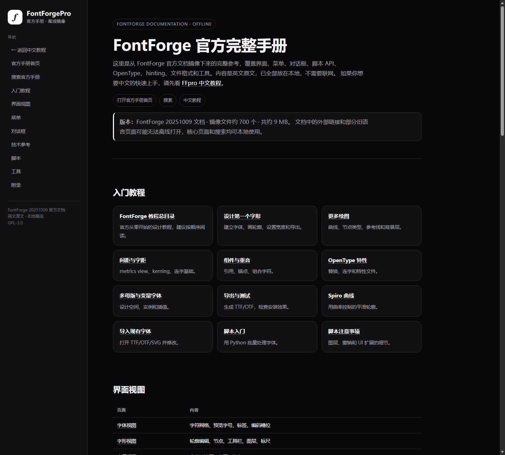

# FontForgePro (FFpro) 2.1.2

A Windows font editor built on the **native FontForge 20251009** application.
FontForgePro keeps all of FontForge's professional features and adds a dark
monochrome appearance, Chinese/multilingual UI handling, a small set of FFpro
workflow tools, a starter font, and an offline manual.

> FontForgePro is an independent product built on FontForge. It is not
> affiliated with or endorsed by the FontForge project.




## Download

Builds are published on the
[releases page](https://github.com/username-xusir/FontForgePro/releases).

The Windows package is self-contained: FontForge, GTK, Python 3.12, the FFpro
plugin, the starter template, and the offline manual are all included.

## What is included

### All of FontForge

The application is the real FontForge 20251009 binary, not a reimplementation.
That means the full feature set is present:

- Glyph drawing, point editing, Spiro, layers and background layers
- Boolean operations, overlap removal, simplification, extrema, hinting
- Components/references, anchors, ligatures, kerning, OpenType features
- Metrics view, font info, validation, Python and legacy scripting
- Multiple masters and variable-font workflows
- Import/export of OpenType, TrueType, WOFF, SVG, UFO, and many other formats

### FFpro additions

Found under **工具 → FFpro 工具** (Tools → FFpro Tools):

| Command | What it does |
| --- | --- |
| 字体体检 / Font Audit | Counts glyphs, reports empty/zero-width/negative-width glyphs, runs FontForge validation |
| 字体预览… / Font Preview... | Exports a temporary WOFF2 and opens a local preview page with editable text and eight sizes |
| 补齐基本字符集 / Add Basic Character Set | Adds ASCII, Latin-1, and common punctuation slots with sensible widths |
| 字形清理 / Clean Glyphs | Rounds coordinates, adds extrema, and corrects contour direction |
| 水平居中 / Center Glyphs | Centers outlines inside the advance width |
| 圆角拐点 / Round Corners | Rounds sharp line-to-line corners to a chosen radius |
| 打开模板字体 / Open Starter Font | Opens a copy of the FFpro Starter template |
| FFpro 中文教程 / FFpro Manual | Opens the bundled Chinese tutorial |
| FontForge 官方手册 / FontForge Manual | Opens the offline mirror of the official FontForge documentation |
| 关于 FontForgePro / About | Version, license, and source information |

### Appearance and localization

- Dark, monochrome editor theme for the font grid, glyph canvas, menus, and dialogs
- UI language follows the Windows system language through FontForge's gettext catalogs
- CJK-capable UI font fallback (Microsoft YaHei UI, Yu Gothic UI, Malgun Gothic)
- Font preview: temporary WOFF2 export opened in a local page with editable text,
  eight sizes (12–144 px), paragraph specimen, and light/dark modes. Preview
  text auto-saves in the browser and has a one-click "保存文字" button — no
  filename dialog.
- Offline mirror of the official FontForge 20251009 documentation (about 700
  files, 9 MB) with a Chinese navigation hub and working local search
- Separate settings directory (`%APPDATA%\FontForgePro`) so an existing
  FontForge installation is not modified

## Quick start

1. Run `FontForgePro.exe`.
2. Open a font, or use **工具 → FFpro 工具 → 打开模板字体** for a starter file.
3. Double-click a glyph, draw with the pen/shape tools, and set the width line.
4. Save the project as `.sfd`, then use **文件 → 生成字体** to export TTF/OTF/WOFF2.
5. Open **工具 → FFpro 工具 → 打开本地教程** for the full Chinese walkthrough.

## Build from source

Requirements:

- Windows 10/11 64-bit
- [FontForge Windows Builds](https://github.com/fontforge/fontforgebuilds)
  installed at `C:\Program Files\FontForgeBuilds` (version 20251009)
- .NET Framework 4.x C# compiler (`csc.exe`)
- PowerShell 5.1+

Build:

```powershell
powershell -NoProfile -ExecutionPolicy Bypass -File build.ps1
```

Output:

- `dist\FontForgePro\` — runnable application directory
- `release\FontForgePro-v2.1.2-win64.zip` — release archive
- `release\FontForgePro-v2.1.2-win64.zip.sha256`

Install for the current user:

```powershell
powershell -NoProfile -ExecutionPolicy Bypass -File install.ps1
```

This copies the app to `%LOCALAPPDATA%\Programs\FontForgePro`, creates Desktop
and Start Menu shortcuts, and registers an uninstall entry under
`HKCU\Software\Microsoft\Windows\CurrentVersion\Uninstall\FontForgePro`.

## Project layout

```
src/Launcher.cs              Windows launcher: profile, locale, branding, icons
src/make_resources.py        Generates the FontForge appearance resource
plugins/ffpro_tools.py       FFpro FontForge plugin
plugins/*.dist-info/         Entry-point metadata that lets FontForge discover it
resources/ffpro.resources    Dark theme + CJK UI font configuration
templates/FFpro-Starter.sfd  Starter font with basic character slots
help/                        Offline Chinese manual, preview template, official docs hub
help/fontforge-docs/        Mirrored official FontForge 20251009 documentation
tools/mirror-docs.mjs       Rebuilds the offline documentation mirror
build.ps1 / install.ps1      Build and install scripts
vendor/                      FontForge source (GPL compliance)
```

The launcher creates `%APPDATA%\FontForgePro\FontForge\prefs` on first run and
points `ResourceFile` at `resources\ffpro.resources`. FontForge is launched with
`-nosplash`, a POSIX locale matching the Windows UI language, and a private
`APPDATA` so settings stay isolated.

The plugin is discovered through the standard `fontforge_plugin` Python entry
point group, so it also works with a normal FontForge installation if the
package is placed on `sys.path`.

## Relationship to the previous FFpro

The earlier `v1.0.0` release was an Electron application built on Glyphr Studio.
It remains available from the repository's release history. Version 2.1.2 is a
different foundation: the native FontForge application. Font files and `.sfd`
projects are compatible with FontForge.

## License

FontForgePro is released under **GPL-3.0**. FontForge 20251009 is also GPL-3.0
(with some BSD-licensed components). See:

- [`LICENSE`](LICENSE) — GPL-3.0 text
- [`THIRD_PARTY_NOTICES.md`](THIRD_PARTY_NOTICES.md) — third-party components
- [`vendor/FontForge-20251009-source.zip`](vendor/FontForge-20251009-source.zip) — corresponding FontForge source
- [`SOURCE.txt`](SOURCE.txt) — source offer for the release package

FontForge source: <https://github.com/fontforge/fontforge>  
FontForge Windows build scripts: <https://github.com/fontforge/fontforgebuilds>
